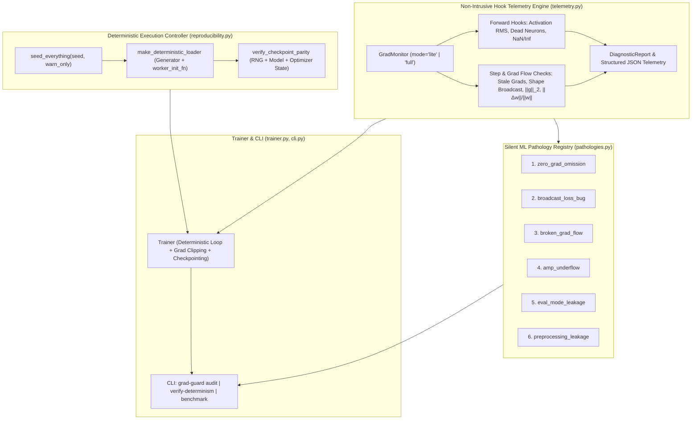

# `grad-guard`: Reproducible PyTorch Training & Numerical Pathology Diagnostics Harness

[](https://github.com/Aanuoluwapo1/grad-guard/actions/workflows/ci.yml)
[](https://www.python.org/downloads/)
[](https://pytorch.org/)
[](https://opensource.org/licenses/MIT)

**`grad-guard`** is a production-grade, CLI-driven PyTorch reproducibility and automated failure-diagnostics library. Deep learning pipelines frequently fail **silently**—runs complete without raising an exception while gradient accumulation bugs, broadcasting mismatches, severed autograd subgraphs, FP16 underflow, evaluation-mode leakage, or train/validation split normalization leakage corrupt convergence and invalidate evaluation metrics.

`grad-guard` provides:
1. **Bit-Identical Reproducibility Controller (`reproducibility.py`)**: Enforces deterministic algorithms across Python, NumPy, and PyTorch (CPU & CUDA), deterministic `DataLoader` worker seeding, full RNG state snapshots, and mid-run checkpoint resume parity verification (`atol=0.0, rtol=0.0`).
2. **Non-Intrusive Hook Telemetry (`telemetry.py`)**: Lightweight forward/backward `GradMonitor` hooks (`lite` and `full` modes) capturing per-layer activation RMS, dead-neuron saturation, `NaN`/`Inf` faults, per-parameter gradient L2 norms, and post-step parameter update ratios $\lVert \Delta w \rVert_2 / \lVert w \rVert_2$.
3. **Structured Silent Pathology Registry (`pathologies.py`)**: 6 canonical silent ML engineering bugs, each implemented with a reproducible `"broken"` variant, a `"fixed"` variant, and an automated root-cause detector.

---

## Architecture Overview



---

## Catalog of 6 Silent ML Engineering Failure Modes

| # | Pathology Case (`REGISTRY`) | Silent Symptom | Root Cause | Automated `grad-guard` Detection Signal | Engineering Fix |
| :- | :--- | :--- | :--- | :--- | :--- |
| **1** | `zero_grad_omission` | Oscillatory loss divergence and linear/quadratic gradient norm inflation | Omitting `optimizer.zero_grad()` causes `backward()` to accumulate into stale `.grad` buffers across steps | `GradMonitor.begin_step()` detects non-zero parameter `.grad` buffers prior to `backward()` | Call `optimizer.zero_grad()` before every forward/backward pass |
| **2** | `broadcast_loss_bug` | Training loss decreases smoothly to a plateau, but model predicts a constant mean | Subtracting target shape `(B,)` from prediction shape `(B, 1)` silently broadcasts into a `(B, B)` pairwise matrix | `GradMonitor.check_loss_shapes()` flags `predictions.shape != targets.shape` before reduction | Align target shape with predictions (`targets.reshape_as(preds)`) |
| **3** | `broken_grad_flow` | Loss decreases slightly (head-only fitting) while upstream encoder weights never move | Accidental `.detach()` or `requires_grad=False` severs the autograd graph between encoder and head | `GradMonitor.check_grad_flow()` flags `grad is None` or `requires_grad=False` on upstream layers | Remove unintended `.detach()` and verify `requires_grad=True` |
| **4** | `amp_underflow` | Loss stalls at initialization value; parameter update ratios drop to exact `0.0` | Small-scale FP16 gradients underflow below $6 \times 10^{-8}$ to exact zero without dynamic loss scaling | `GradMonitor.check_grad_flow()` flags exact-zero gradients and $\lVert g \rVert_2 \lt \tau_{\mathrm{vanish}}$ | Apply dynamic loss scaling (`GradScaler`) before `backward()` and unscale before `step()` |
| **5** | `eval_mode_leakage` | Stochastic validation metrics across identical inputs and corrupted `BatchNorm` running stats | Failing to call `model.eval()` before validation leaves `Dropout` active and `BatchNorm` updating stats | `GradMonitor.check_eval_mode_integrity()` flags stochastic/norm submodules with `training=True` | Call `model.eval()` and wrap evaluation in `torch.no_grad()` |
| **6** | `preprocessing_leakage` | Optimistic validation metrics during development followed by test-time degradation | Fitting feature standardization (`mean`/`std`) on combined train+val data before splitting | `check_split_normalization_integrity()` detects deviation between scaler stats and train-only split | Fit preprocessing statistics strictly on the training split |

---

## Quick Start

### Installation

```bash
python -m venv .venv
# Windows PowerShell:
.\.venv\Scripts\Activate.ps1
# Linux / macOS:
# source .venv/bin/activate

pip install -e ".[dev]"
```

### Programmatic Usage

```python
import torch
from torch import nn
from torch.utils.data import TensorDataset
from grad_guard import (
    TrainConfig,
    Trainer,
    make_deterministic_loader,
    seed_everything,
)

# 1. Enforce bit-for-bit determinism across Python, NumPy, and PyTorch
seed_everything(42)

dataset = TensorDataset(torch.randn(128, 16), torch.randn(128, 1))
loader = make_deterministic_loader(dataset, batch_size=16, seed=42)

model = nn.Sequential(nn.Linear(16, 32), nn.ReLU(), nn.Linear(32, 1))
optimizer = torch.optim.AdamW(model.parameters(), lr=1e-2)

# 2. Train with automated GradMonitor hooks and finite-step assertions
trainer = Trainer(
    model=model,
    optimizer=optimizer,
    loss_fn=nn.MSELoss(),
    config=TrainConfig(seed=42, max_steps=25, monitor_mode="full"),
)
result = trainer.fit(loader)
assert result.report is not None and result.report.healthy
trainer.close()
```

---

## CLI Verification & Benchmark Outputs

### 1. Automated Silent Pathology Audit (`grad-guard audit --all`)

```text
============================================================================================================
 GRAD-GUARD: SILENT ML PATHOLOGY AUDIT SUITE (BROKEN VS. FIXED)
============================================================================================================
Pathology Case          | Mode   | Status   | Detected Code          | Step | Init Loss | Eval Metric
------------------------------------------------------------------------------------------------------------
zero_grad_omission      | broken | CAUGHT   | zero_grad_omission     |    2 |    6.4939 |      1.1687
zero_grad_omission      | fixed  | HEALTHY  | None                   |    - |    6.4939 |      0.1695
------------------------------------------------------------------------------------------------------------
broadcast_loss_bug      | broken | CAUGHT   | broadcast_loss_bug     |    1 |    6.9424 |      6.6866
broadcast_loss_bug      | fixed  | HEALTHY  | None                   |    - |    7.2310 |      0.1301
------------------------------------------------------------------------------------------------------------
broken_grad_flow        | broken | CAUGHT   | broken_grad_flow       |    1 |    6.3005 |      3.2417
broken_grad_flow        | fixed  | HEALTHY  | None                   |    - |    6.3005 |      0.2203
------------------------------------------------------------------------------------------------------------
amp_underflow           | broken | CAUGHT   | amp_underflow          |    1 |    6.2325 |      6.2400
amp_underflow           | fixed  | HEALTHY  | None                   |    - |    6.2325 |      0.1820
------------------------------------------------------------------------------------------------------------
eval_mode_leakage       | broken | CAUGHT   | eval_mode_leakage      |   25 |    7.1659 |      0.7653
eval_mode_leakage       | fixed  | HEALTHY  | None                   |    - |    7.1659 |      0.2893
------------------------------------------------------------------------------------------------------------
preprocessing_leakage   | broken | CAUGHT   | preprocessing_leakage  |    0 |    7.1950 |     26.5190
preprocessing_leakage   | fixed  | HEALTHY  | None                   |    - |    6.9305 |     10.0081
------------------------------------------------------------------------------------------------------------
Audit Result: ALL 6 PATHOLOGIES CAUGHT & REPAIRED (PASS)
============================================================================================================
```

### 2. Reproducibility & Mid-Run Checkpoint Parity (`grad-guard verify-determinism --seed 42 --steps 25`)

```text
============================================================================================
 GRAD-GUARD: REPRODUCIBILITY & CHECKPOINT PARITY VERIFICATION (SEED=42, STEPS=25)
============================================================================================
1. Independent Multi-Step Run A vs Run B Max Loss Diff   : 0.000e+00
2. Independent Multi-Step Run A vs Run B Max Weight Diff : 0.000e+00
3. Mid-Run Checkpoint Resume (Step 12/25) Max Loss Diff : 0.000e+00
4. Mid-Run Checkpoint Resume (Step 12/25) Max Param Diff: 0.000e+00
--------------------------------------------------------------------------------------------
Determinism Verdict: BIT-IDENTICAL PARITY VERIFIED (0.000e+00)
============================================================================================
```

### 3. Telemetry Hook Throughput & Memory Overhead (`grad-guard benchmark`)

```text
============================================================================================
 GRAD-GUARD: TELEMETRY HOOK THROUGHPUT & MEMORY OVERHEAD BENCHMARK (60 STEPS)
============================================================================================
Monitor Mode     |  ms / step |  steps / sec |  Overhead (%) | Peak Memory (KB)
--------------------------------------------------------------------------------------------
disabled (None)  |      2.267 |        441.2 |         +0.0% |             42.4
lite             |      2.953 |        338.6 |        +30.3% |             89.5
full             |      4.302 |        232.4 |        +89.8% |            174.0
============================================================================================
```

---

## Project Layout

```text
grad-guard/
├── .github/workflows/ci.yml        # GitHub Actions CI (ruff + pytest + CLI audits & benchmarks)
├── src/grad_guard/
│   ├── __init__.py                 # Public package exports
│   ├── cli.py                      # CLI entry point (audit, verify-determinism, benchmark)
│   ├── pathologies.py              # 6 silent ML failure cases (broken vs. fixed) & REGISTRY
│   ├── reproducibility.py          # seed_everything, deterministic DataLoader, checkpoint parity
│   ├── telemetry.py                # GradMonitor forward/backward hooks & DiagnosticReport
│   └── trainer.py                  # Deterministic Trainer with clipping & JSON telemetry export
├── tests/
│   ├── test_pathologies.py         # Parametrized broken vs. fixed tests across all 6 pathologies
│   ├── test_reproducibility.py     # Seed determinism, DataLoader parity, and checkpoint tests
│   └── test_telemetry.py           # NaN/Inf hook assertions, vanishing/exploding grads, update ratios
├── .gitignore
├── pyproject.toml
└── README.md
```

## Testing & Linting

```bash
ruff check .
pytest -v -W error
```
